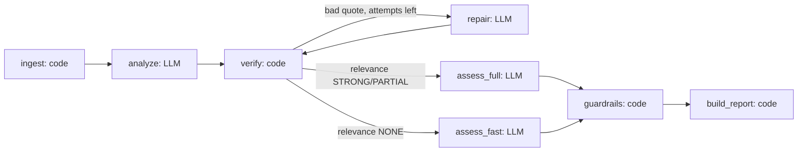

# RFP Triage Agent

An evidence-first Streamlit app that reads one text-searchable government RFP and returns a
human-readable bid triage report plus downloadable JSON and calendar files.

**Live app:** `https://<your-app>.streamlit.app` (replace after deployment)

## What It Does

- Extracts facts, dates, requirements, ambiguities, and disqualification gates from every page.
- Verifies each quoted source against the PDF before company fit is assessed.
- Scores fit against one editable, verbatim idiaz.io profile and applies deterministic no-bid rules.
- Shows the Disqualification Radar and a merged Do-By Calendar with `.ics` download.
- Caches reports by document hash, model, and prompt version to conserve free-tier quota.

The app does not search for RFPs, write proposals, or use outside facts about idiaz.io.

## Quick Start

Python 3.11 or newer is required.

```bash
python -m venv .venv
# Windows: .venv\Scripts\activate
source .venv/bin/activate
pip install -r requirements.txt
cp .env.example .env
```

Set at least one of `GEMINI_API_KEY` or `GROQ_API_KEY`. The default provider order is
`gemini,groq`; configure it with `LLM_PROVIDER_ORDER`. `GEMINI_FALLBACK_MODEL` optionally adds
a second Gemini model before the app moves to Groq. The app reads environment variables first
and then Streamlit secrets.

```bash
streamlit run app.py
```

Optional Docker path:

```bash
docker build -t rfp-triage-agent .
docker run --rm -p 8501:8501 -e GEMINI_API_KEY=your_key rfp-triage-agent
```

## Architecture



| Node | Why code or LLM |
|---|---|
| `ingest` | PDF parsing, page limits, and scanned detection are deterministic. |
| `analyze` | A model is useful for reading varied prose, tables, appendices, and forms. |
| `verify` | Source quotes must be checked mechanically, not trusted because a model supplied them. |
| `repair` | The model gets one narrow chance to find corrected evidence for only failed items. |
| `assess_full` | Fit and delivery judgment need language understanding, but only over verified extraction. |
| `assess_fast` | Clearly unrelated work gets a cheaper, decisive no-bid while retaining a full report. |
| `guardrails` | Weights, rounding, score caps, and forced no-bids must be repeatable. |
| `build_report` | Date checks, radar ordering, calendar creation, and JSON assembly are deterministic. |

LangGraph earns its place here because the verify-and-repair loop and fast no-bid route are real
control-flow branches. Without those branches, plain Python would be simpler.

## Model Choice

The default Gemini model is `gemini-3.5-flash-lite`, configurable with `GEMINI_MODEL`. Google's official model
page, checked on 2026-11-25, lists it as a stable Flash-Lite model with a 1,048,576-token input
limit, 65,536-token output limit, structured outputs, and free-tier use. Those properties fit
long RFPs and the no-payment-card constraint. Temperature is zero and thinking uses the model's
supported `MINIMAL` level for predictability and latency.

The second provider uses the official Groq SDK and `openai/gpt-oss-120b`, configurable with
`GROQ_MODEL`. Groq's current model page lists a 131,072-token context window, and its rate-limit
page lists the model under Free Plan limits. Calls use strict JSON-schema structured output.
Both providers retry 429 and 5xx responses with exponential backoff, then fail over in the
configured order.

All provider access lives in `rfp_agent/llm.py` behind
`generate_json(prompt, schema) -> validated object`.

## Accuracy Controls

Every extracted fact, deadline, requirement, gate, and ambiguity carries a short quote and a
1-based physical page. Verification normalizes Unicode, quotes, dash characters, soft hyphens,
line-break hyphenation, whitespace, and case. It checks the stated page, searches other pages and
corrects the page number, then permits fuzzy matching only at 92 or higher. Unsupported items are
repaired at most twice and otherwise remain visibly `UNVERIFIED`.

The assessment receives a copy containing only verified evidence plus this exact profile:

> A US-registered, AI-native engineering studio with a small senior team. What we build:
> automation platforms, compliance tooling, AI-integrated ops software, web and mobile apps.

Missing company facts therefore remain `UNKNOWN`, never inferred as `PASS`.

## Scoring And Guardrails

The raw score is:

`0.35*scope_fit + 0.25*eligibility + 0.20*delivery_feasibility + 0.20*commercial_risk`

Code rounds half up. A `scope_fit` of 2 or lower caps the result at 2 and forces `NO_BID`. Any
failed gate also forces `NO_BID`. If code changes the model decision, the reason is shown in the
report. Suspicious score/decision combinations produce warnings but are not silently changed.

## Disqualification Radar

The radar puts mechanical rejection risks before proposal scoring: mandatory meetings,
eligibility, registrations, bonds, submission mechanics, forms, addenda, onsite rules, and price
ceilings. Each row includes status, required action, do-by date, consequence, and verified quote.
The same actions are merged with all deadlines into a chronological calendar and `.ics` file.

**Screenshot:** `TODO(candidate): add a screenshot after the live deployment is working.`

## Tests And Sample Results

Network-free checks:

```bash
pip install -r requirements-dev.txt
ruff check .
ruff format --check .
pytest
```

Current local result: **40 passed** on Python 3.13.5. The tests cover evidence normalization and
matching, dates, scoring guardrails, radar sorting, RFC 5545 parsing, ingest validation, and both
LangGraph routes with a FakeLLM, plus provider retry and failover behavior.

Run the two real PDFs with:

```bash
python scripts/run_samples.py
```

Create hash-addressed saved results only through the live pipeline:

```bash
python scripts/save_precomputed.py samples/example.pdf
python scripts/compare_providers.py
```

| Sample | Expected | Real result | Time |
|---|---:|---:|---:|
| Port Alder `PA-DPI-2026-114` | BID, score >= 7 | PASS | 22.08s |
| Larkspur `LC-FM-2027-03` | NO_BID, score <= 2 | PASS | 14.87s |

Measured locally on 2026-11-25 with `gemini-3.5-flash-lite`; free-tier latency can vary.

## Deployment

The target is Streamlit Community Cloud because it is free, deploys directly from GitHub, and
supports encrypted app secrets. Select `app.py` as the entry point, add the provider API keys in
the Cloud secrets editor, and keep `.streamlit/secrets.toml` out of git. No secret is baked into
the Docker image, cache, report, prompt logs, or CI.

## What Went Wrong And How I Fixed It

`TODO(candidate): Replace these prompts with short, truthful observations from your own testing.`

- `TODO(candidate): What extraction error did one sample reveal? How did you reproduce and fix it?`
- `TODO(candidate): What did quote verification reject, and was that rejection correct?`
- `TODO(candidate): What changed after the first live deployment?`

Do not fabricate a story. This section is strongest when it describes one or two concrete failures
you personally observed.

## Known Limitations

- Scanned PDFs are rejected. Next: add OCR with page-level confidence and retain physical pages.
- PDFs over the configured limit are rejected. Next: add verified chunked map-reduce extraction.
- The model can still miss or misunderstand language. Next: add more golden RFPs and human review.
- Free-tier quotas can still exhaust both configured providers during sustained traffic.
- This is bid triage, not legal advice. Next: add an explicit review/approval workflow.

AI coding assistants were used; the author is responsible for the result and can explain every part.
